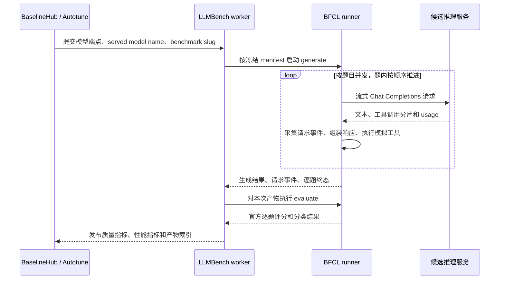

# BFCL V4 接入 LLMBench 设计方案

新增 `bfcl_v4` 模块，由现有 LLMBench worker 调用官方 BFCL runner。官方代码负责加载题集、调度并发、执行模拟工具、推进多轮对话和评分。LLMBench 负责选择待测端点、采集流式请求指标、管理运行生命周期，并把质量和性能结果回传给 BaselineHub / Autotune。

首版采用原生 function calling，冻结单轮工具选择、参数、并行调用、无关工具，以及 `multi_turn_base` 的题目子集。结果标为 **BFCL V4 子集**，展示每个类别的准确率和覆盖题数。工具执行使用 BFCL 自带模拟环境，可在现有 CPU worker 上访问已部署的推理服务。完整 V4 的网页搜索、记忆和格式敏感性，以及榜单全量聚合口径，留待另行接入。[BFCL V4 榜单](https://gorilla.cs.berkeley.edu/leaderboard.html) · [官方 runner 使用说明](https://github.com/ShishirPatil/gorilla/tree/main/berkeley-function-call-leaderboard)

## 1. 执行架构

生产 worker 继续使用 [现有模块接口](../bench/modules/base.py#L261) 和 [队列执行入口](../platform/backend/app/queue/jobs.py#L1321)。镜像构建时给 BFCL 安装一套独立锁定的 Python 虚拟环境。当前 worker 的 Python 3.12 满足上游声明，但 NumPy 与 filelock 锁定版本不同。独立安装避免改动现有模块依赖。构建时验证目标架构、数据资源和 CLI 的两个命令。采用同一套 BFCL pin 构建和验收，避免运行时联网安装。[Worker 镜像](../platform/backend/Dockerfile#L25) · [Worker 依赖锁](../platform/backend/uv.lock#L1460) · [BFCL 依赖声明](https://raw.githubusercontent.com/ShishirPatil/gorilla/main/berkeley-function-call-leaderboard/pyproject.toml)

## 2. 模块参数与冻结协议

| 字段 | 语义 | 冒烟起点 |
| --- | --- | --- |
| `task_set` | worker 注册的 manifest 名，严格校验题目及依赖 | `bfcl-v4-smoke-v1` |
| `cases_per_category` | 五类题集每类选取的题数，按固定 revision 的题号升序取前 N 道；冒烟题集固定 | 1 |
| `concurrency` | 映射到官方 `--num-threads`，表示活跃题目上限 | 2 |
| `request_timeout_seconds` | 单次模型调用的墙钟预算，包含本次调用的重试与退避 | 120 |
| `max_seconds` | 模块总墙钟预算，包含探测、生成、评分和落盘 | 1800 |
| `probe_endpoint` | 正式生成前用官方 runner 串行跑一次固定多轮题，只报告能力观察结果 | false |
| `export_replay_trace` | 在本次生成阶段导出去敏后的请求轨迹，供后续独立 Replay benchmark 冻结使用 | false |

待测端点、served model name 和凭据从 submission 读取。URL 复用 [to_base_url](../utils/api.py#L36) 去除完整 endpoint 后缀，并在探测中确认最终路径。manifest 包含有序 case ID、类别、必要的 `depends_on`、数据与 runner revision、handler 版本、生成参数、官方轮次和步骤限制、并发、重试策略、预热协议及其哈希。参数解析后二次保存实际执行值。比较缓存开关时固定这些字段，并记录缓存条件与服务部署标识。基线和候选使用相同协议。

官方 `generate` 用 `--run-ids` 读取当前项目目录中的题目清单。每个 attempt 独立设置 `BFCL_PROJECT_ROOT`、结果和评分目录。评分读取本 attempt 的 generation 结果。冻结子集使用锁定版本支持的部分评分方式，并按 manifest 自行检查预定题的完整覆盖。对 `--run-ids`、评分类别筛选和结果文件结构写契约测试。[CLI 源码](https://raw.githubusercontent.com/ShishirPatil/gorilla/main/berkeley-function-call-leaderboard/bfcl_eval/__main__.py)

## 3. 官方 runner 与流式 handler 的接缝

在独立 runner 入口注册基于官方 `OpenAICompletionsHandler` 的小型适配。生成与评分入口载入同一注册配置。BFCL registry key 用作官方路由及文件标识。发往端点的 `model` 使用 submission 的 served model name。适配范围限定在 Chat Completions 调用、响应组装和遥测，工具定义转换、多轮循环、解码和官方评分沿用上游。上游入口、注册映射和返回对象形状都纳入 pin 的兼容测试。[BFCL handler 注册与调度](https://raw.githubusercontent.com/ShishirPatil/gorilla/main/berkeley-function-call-leaderboard/bfcl_eval/_llm_response_generation.py) · [官方 OpenAI handler](https://raw.githubusercontent.com/ShishirPatil/gorilla/main/berkeley-function-call-leaderboard/bfcl_eval/model_handler/api_inference/openai_completion.py)

1. **准备请求。** 透传官方生成的消息、工具定义、采样参数和模型所需字段，增加 `stream=true` 及 `stream_options.include_usage=true`。对目标端点探测原生工具调用、工具结果回填及流式 usage。预热请求在正式计时之外。认证配置只存在于进程运行上下文。
2. **采集和组装。** 使用单调时钟记录发出请求、首个有效分片及流结束时间。组装文本与按 index 分组的 `tool_calls`，保留调用 ID、工具名、参数字符串、顺序、结束原因和最终 usage。收齐参数后再交给官方解码。工具调用专用响应允许文本为空。保留原 handler 期望的完整响应形状，确保官方循环仍能通过同一个调用 ID 回填工具结果。
3. **识别完成。** 流可在结束原因之后发送只有 usage 的尾帧，继续读到结束或超时。遇到连接中断、非法响应结构或缺失完成信号时写清楚终态。合法响应里的错误工具名、无效参数或意外未调用由官方判分。缺失 usage 时质量路径仍应能返回官方可评分的响应，真实遥测保留 null。针对上游直接读取 usage 的地方做兼容处理，并验证它不会将缺报算成实测零。
4. **标记重试。** 记录每次实际发出的 HTTP 尝试。明确指定一个重试责任层，避免 SDK 和 runner 重试相乘。对允许重试的错误按协议退避，已收到有效生成内容后的断流保留为失败尝试。一次模型调用只有一个成功响应进入官方状态机。LLMBench 中断命令时关闭子进程和连接。
5. **关联题目。** runner 的题目入口设置线程内 case ID，模型调用钩子递增该题的调用序号。需要精确轮次和步骤时，只有官方钩子能提供才记录，无法确定时留空。请求事件由单写入端逐条落盘，记录以便部分失败后仍可诊断。模型服务端时钟与本地单调时钟分别使用。

上游按题目调度，题内工具执行和模型请求按顺序推进。活跃题数和模型请求并发分别观测，避免把 `concurrency=8` 当作实测 HTTP 并发。评分阶段不承担生成负载。[生成调度源码](https://raw.githubusercontent.com/ShishirPatil/gorilla/main/berkeley-function-call-leaderboard/bfcl_eval/_llm_response_generation.py)

## 4. 指标与统计口径

每个 HTTP 请求尝试记录 `submission_id`、`module_run_id`、`attempt_id`、`case_id`、`request_index`、`http_attempt`、`phase`、时间、HTTP 状态、结束原因、错误分类、`input_tokens`、`output_tokens` 和 `cached_input_tokens`。预热、生成、评分和固定回放各有 phase，闭环吞吐只使用生成阶段。

| 指标 | 统计口径 |
| --- | --- |
| `accuracy`、`accuracy_<category>` | 完整有效子集的通过数除以预定题数。合并值按题加权，分项各用本类题数。官方榜单聚合另存原始产物。 |
| `ttft_p50_ms`、`ttft_p90_ms`、`ttft_p99_ms` | 成功完成的请求从实际发出到首个有效文本或 `tool_calls` 分片的时间。跳过角色、空分片和 usage；首版跳过仅 reasoning 的分片。报告有效样本数和覆盖率。 |
| `request_e2e_p90_ms` | 成功请求从发出到完整结束的耗时分位数。 |
| `generation_wall_seconds`、`grading_wall_seconds` | 并发生成和官方评分各自的墙钟。生成窗口从开始派发至最后一题终态，包含等待工具及重试。 |
| `request_throughput_rps`、`successful_request_rps` | 实际发出的 HTTP 尝试数及成功数，各除以生成墙钟。 |
| `input_tokens_per_second`、`output_tokens_per_second` | 具有对应 usage 的成功请求的 token 总数除以生成墙钟。各报 usage 覆盖率。 |
| `cached_input_tokens`、`cache_hit_rate` | 仅在同时具有有效缓存和输入 token 用量的请求上计算 `Σ cached / Σ input`。分别报告全部、单题首请求和后续请求，并报告匹配用量覆盖率。缺失为 null，实测零保留为 0。 |
| `passed_cases_per_hour` | 官方通过题数乘以 3600，再除以生成墙钟。适合用于同冻结子集的闭环调优。 |
| `http_attempt_count`、`request_error_count`、`retry_count`、`infra_error_count` | 报请求尝试、失败、重试及基础设施异常。逐题另报模型请求数和任务墙钟，用于识别候选轨迹改变。 |

用量优先取端点返回值。常见缓存字段是 `usage.prompt_tokens_details.cached_tokens`，其他字段映射按端点类型显式配置并在探测中核对。输入分母为零、样本不足或端点缺报时按指标契约留空或标记覆盖不足。首版注册指标描述和覆盖门槛。将必需指标用于排序前，先在实际端点确认可稳定获取。端点缺少缓存明细时，仍可观察两臂时延差，但无法由本模块确认命中量。

## 5. 缓存对照协议

缓存开关通常属于模型服务部署配置。由 Autotune 或部署侧建立 cache off/on 两个候选条件，LLMBench 从 submission 记录经过验证的条件和候选配置。本模块不改变在线端点的缓存状态。两臂固定模型权重、tokenizer、chat template、tool parser、采样参数、GPU 配置、并发与题集。预先定义冷启动或预热协议，使用独立服务实例或服务支持的清理机制，并记录任何未能验证的初始状态。两臂不同时争用同一服务配额或 GPU。按预定重复次数记录每次结果，条件允许时交替运行顺序。

| 对照 | 执行方式 | 结果怎么解释 |
| --- | --- | --- |
| **闭环 cache off/on** | 两个候选分别用 `bfcl_v4` 对同一 manifest 跑官方多轮闭环。 | 反映真实任务性能和质量。结合题目通过率、请求数、输入输出 token 和工具等待判断。模型可能走出不同轨迹，差值同时含工作量变化。 |
| **固定请求 cache off/on** | 从一次官方闭环生成导出模型实际 HTTP 请求体，删除敏感字段，冻结为 Replay JSONL 和 sidecar。两臂使用同一文件、相同流式参数和并发。 | 输入请求体可复现，适合比较 TTFT、RPS 和 token 吞吐。输出长度仍可能变化，应同时报告。Replay 现有缓存聚合将缺报按零处理，因此缓存开关结论必须先验证用量覆盖，或补齐覆盖统计后再进入调优。 |
| **有序多轮缓存对照** | 固定轨迹按 `case_id` 分组，组内等上一请求完成后再发下一请求，组间并发。保留 sidecar 的请求顺序与可选等待策略。 | 用于验证多轮前缀在相同会话时序下能否复用。当前 Replay 按独立请求并发，上线此对照需要增加按会话调度，或先使用小规模有序验证入口。 |

单轮题的 Replay 输入也可直接从 BFCL 原始题目生成，作为低成本固定负载。多轮回放使用冻结的历史消息与工具结果。官方多轮准确率始终取对应候选的闭环结果。冻结请求体时另外保存 case ID、请求序号、源 run、trace hash 和生成协议。跨端点先核对工具历史及可选字段兼容。[Replay 调度实现](../bench/tests/functional/replay.py#L789) · [Replay 缓存聚合](../bench/tests/functional/replay.py#L1926) · [Replay 记录格式](../bench/replay_test/log_replay_tool.py#L554)

## 6. 生命周期、产物与平台绑定

- **有效运行。** 所有预定题有可解释的结局且官方结果覆盖完整。工具选错、参数值错误、任务未完成或触及官方步骤上限计入题目失败。
- **基础设施失败。** 端点认证失败、持续不可达、runner 非零退出、评分器异常、缺少预定题结果或重复 ID，均保留诊断产物并将模块标为失败。单题因传输重试耗尽而无法完成时标为基础设施异常，首版整批质量结果不进入调优排序。生成 runner 可能把推理异常写入结果后继续执行，适配层须结合请求事件和官方结果识别。不可用的必需遥测指标按配置阻止结果进入排序。
- **取消和预算。** worker 定期检查 `cancel_event` 与总预算，停止当前子进程组，必要时升级终止，并等待落盘或保留可读取的部分文件。探测、生成、评分和落盘都计入总时限。attempt 间使用全新工作目录，完成写入后再发布终态。[进程组终止先例](../bench/modules/perf_guidellm_sweep.py#L1388)
- **产物。** 保存 `manifest.json`、官方生成与评分目录、`request_events.jsonl`、`case_results.jsonl`、`summary.json` 和产物索引。启用固定回放导出时另存去敏的 JSONL 与 sidecar。默认遥测只存必要元数据，凭据、认证头和含凭据的 URL 禁止落盘。worker 目前从 `ModuleResult.artifacts` 取第一个路径回传，首位放产物索引并在真实部署验收读取路径和保留策略。[Worker 产物回传](../platform/backend/app/queue/jobs.py#L1502)
- **Autotune。** 建议注册 `bfcl-v4-tool-use-v1`。按现有流程绑定 BaselineHub track，验证 Autotune 能采集带 `bfcl_v4.` 前缀的指标。闭环可在分项准确率和 TTFT 红线下按 `passed_cases_per_hour` 排序。固定回放使用自己的 benchmark 配置和性能目标。阈值由同一冻结协议的基线实测确定。

## 7. 实施与验收

镜像、真实端点、平台联调与缓存对照的执行步骤见 [生产验收执行指南](bfcl-v4-production-acceptance.zh.md)。

| 阶段 | 交付 | 通过条件 |
| --- | --- | --- |
| 1. 官方 runner 连通 | 独立虚拟环境、BFCL pin、模型映射、冒烟 manifest | 在真实 worker 镜像中跑一条单轮、一条多轮，核对出站 URL 和模型名、工具结果回填、逐题评分。以并发 2 验证不同题重叠且同一题顺序执行。 |
| 2. 流式兼容和遥测 | handler 适配和逐请求事件 | 在确定性测试响应下比较非流式与流式的工具名、参数、tool_call_id 和官方判分。覆盖并行调用分片、空分片、工具调用首分片、尾帧 usage、断流、重试、缺报和实测零。人工核算一条多轮题的 TTFT 及全批吞吐和缓存分母。 |
| 3. LLMBench 集成 | 模块注册、评分回传、取消、平台绑定 | 提交后能看进度、质量和性能指标。验证生成时取消、评分时取消、总时限、结果缺失、重跑目录隔离和产物可读。最终验证 Autotune 完成或取消后的模型回收。 |
| 4. 缓存对照 | 冻结轨迹、两臂协议、对照报告 | cache off/on 各重复运行，核对 trace hash、配置差异和用量覆盖。需要验证多轮因果时序时，再验收同会话后发请求的开始时间晚于前一请求完成时间。 |

## 8. 实施进度（2026-11-18）

仓库已接入 BFCL V4 闭环模块，并在本地用固定版本的官方 runner 验证。两题冒烟中，流式与非流式评分一致，单轮通过，多轮完成工具结果回填后按预期判为未通过。五类题集也通过了逐类覆盖检查。

| 阶段 | 已实现和验证 | 待部署验收 |
| --- | --- | --- |
| 1. 官方 runner 连通 | 固定 commit `6ea57973c7a6097fd7c5915698c54c17c5b1b6c8`，仓库包含 Linux AMD64 的 wheel 哈希锁、独立安装阶段和 CI 冒烟。两题冒烟验证模型名、认证、工具调用 ID 回填、题间重叠和题内顺序。 | 在 CI 或 Linux AMD64 worker 构建新镜像，再对真实端点验证流式行为。ARM64 worker 需要单独可用的 BFCL 环境。 |
| 2. 流式兼容和遥测 | 原生工具调用组装、逐 HTTP 尝试事件、生成与评分墙钟、峰值并发、用量覆盖和缓存分母已接入。可选端点探测用官方生成器串行运行一题，结果单独落盘。TTFT 跳过仅 reasoning 和结构分片。零重试是默认冻结协议，可配置在 HTTP 429 和 5xx 时重试。 | 核对生产端点的流式 usage、缓存字段和固定协议下的基线数据。当前请求超时由 SDK I/O 超时和分片间墙钟检查共同约束，模块总时限由 worker 停止子进程组。 |
| 3. LLMBench 集成 | 注册 `bfcl_v4` 和可导入的五题 benchmark，保存 submission、run 和 attempt 身份，支持按阶段报告进度、取消、总预算、失败判定和必需指标覆盖门槛。共享存储可保留并下载成功或失败的归档。 | 在真实部署导入 benchmark，启用归档共享卷，验收下载权限、保留策略、BaselineHub track、Autotune 指标读取及任务完成或取消后的模型回收。 |
| 4. 缓存对照 | 导出 Replay JSONL、顺序 sidecar 和哈希。Replay 缓存命中率使用配对用量分母，单独报告覆盖率。运行步骤见 [BFCL worker 与缓存对照说明](../bench/bfcl/README.md)。 | 仍需使用真实 cache off/on 部署各重复运行并出具对照报告。验证多轮前缀的因果时序时，还需要按会话调度 Replay。 |
